# Uçtan Uca Üretim Mimarisi

Bu mimari 14 açık kaynak GitHub projesinin (`video-use`, `ffmpeg-skill`, `kinocut`, `OBS_MCP`, `DeepFilterNet`, `auto-editor`, `video-editing-skill`, `CLI-Anything`, `youtube-uploader-mcp`, `youtube-mcp-server`) en sağlam üretim kurallarını **CONTENTY** stüdyosunun 3 ana formatına uyarlar.

## 1. Ana Boru Hattı Akışı

```mermaid
flowchart LR
    A["01-raw (OBS / Podcast / Ses)"] --> B["Ses Temizliği (DeepFilterNet + HPF)"]
    B --> C["Kaba Kurgu (auto-editor / Word-Level ASR)"]
    C --> D["Strateji & Kesim Planı Onayı (edl.json)"]
    D --> E["Segment Çıkarımı + 30ms Afade + Concat"]
    E --> F["Yüzsüz Görsel / B-Roll / Audiogram"]
    F --> G["Altyazı (SRT + ASS) & Bölüm Damgaları"]
    G --> H["Loudness Mastering (-14 / -16 LUFS)"]
    H --> I["Kalite Kapısı (ebur128 + Contact Sheet)"]
    I --> J["16:9 Final + 9:16 Shorts + Thumbnail"]
    J --> K["YouTube API v3 Private Draft Yükleme"]
```

---

## 2. Üç Kanal Formatı İçin Çalışma Rotaları

### Rota A: OBS Canlı Yayın → Uzun Özet + Dikey Shorts
1. **Yayın Öncesi (`OBS_MCP`):**
   * `set_record_directory` → `c:\Users\HP\YOUTUBE\workspace\01-raw`
   * `clean_audio_input(input_name="Mic/Aux")` → OBS içinde doğrulanmış Noise Gate → RNNoise → Compressor zinciri.
   * `diagnose_av_health()` → kare düşüşü / disk / encoder kontrolü.
   * Hybrid MP4 kaydı + Replay Buffer aktif (`start_replay_buffer`).
2. **Yayın Sırasında:**
   * Konu değişimlerinde `create_record_chapter("Konu Başlığı")` ile canlı bölüm işareti düşülür.
   * Vurucu anlarda `save_replay_buffer()` ile anlık Shorts aday klibi ayrı dosyaya alınır.
3. **Yayın Sonrası:**
   * Ham kayıt `01-raw/` içinden alınır; [[skills/audio-and-roughcut/SKILL|audio-and-roughcut]] ile sessizlik/boşluklar budanır.
   * `kinocut` (`shorts-plan-show` → `shorts-review` → `shorts-render`) veya `ffmpeg-skill` (`scenes.py --highlights` + `fit.py --aspect 9:16`) ile 3–5 adet dikey 1080×1920 Shorts çıkarılır.

### Rota B: Yüzsüz (Faceless) Bilgi / Felsefe / Teknoloji / Politika Videosu
1. **Planlama (`creative_direction.md`):**
   * `CLI-Anything` video matrisi kuralı: Kurgudan önce tek cümlelik vaat, bölüm eğrisi (Hook → Problem → Kanıt → Karşı Tez → Kapanış), ses atmosferi ve kaynak hakları (`sources.json`) yazılır.
2. **Ses-Öncelikli Kurgu (Audio-First):**
   * Önce seslendirme kaydedilir, `DeepFilterNet` ile temizlenir, kelime-zamanlı (word-level) transkripsiyon alınır.
   * Kesimler ve görsel değişimleri **kelime zaman damgalarına** kilitlenir.
3. **Görsel Katmanlama (Yüzsüz Motor Seçici):**
   * Basit kart/alıntı/sayaç → **PIL + PNG + FFmpeg** (en hızlı, sıfır Node gereksinimi).
   * Felsefi/teknik diyagram, grafik, devlet/sistem akışı → **Manim** (`manim-video`).
   * Modern kinetik tipografi, web/haber ekranı, veri görselleştirme → **HyperFrames** (HTML/CSS/GSAP) veya **Remotion**.
   * B-roll stok/kamu malı görüntüler → Wikimedia Commons / CC kaynakları + `broll.py` + `sources.json` lisans kaydı.

### Rota C: Podcast / Uzun Sohbet Kaydı
1. **Kaba Kurgu (`podcast` Profili):**
   * Hızlı YouTube temposu yerine doğal nefes bırakılır: `0.80 s` üzeri duraksamalar kısaltılır, cümle ortası `0.40 s` / cümle sonu `0.60 s` doğal oda sesi (room tone) korunur.
   * Hedef ses yüksekliği: Podcast için **`-16 LUFS`**, YouTube video olarak yayınlanacaksa **`-14 LUFS`** (true peak ≤ `-1.0 dBTP`).
2. **Görselleştirme:**
   * Video kaydı yoksa `ffmpeg-skill` içindeki `render.py --template audiogram` veya `waveform.py` ile kanal kapaklı dalga formu videosu üretilir.
   * En güçlü 60 saniyelik 3 kesit `9:16` dikey + gömülü Türkçe altyazılı Shorts'a dönüştürülür.

---

## 3. Değiştirilemez Üretim Doğruluk Kuralları (Hard Rules)

Bu kurallar `video-use`, `ffmpeg-skill` ve `kinocut` kaynaklarından ayıklanan **sessiz hataları önleyen** teknik zorunluluklardır:

> [!WARNING] İhlal Edilirse Bozuk Çıktı Üreten 10 Kural
> 1. **Altyazı her zaman EN SONDA işlenir:** Tüm overlay, grafik ve 9:16 kırpmalar bittikten sonra altyazı gömülür; yoksa grafikler yazıyı kapatır veya yazı kadraj dışına taşar.
> 2. **Segment bazlı çıkarım + kayıpsız birleştirme:** Çoklu kesimde her parça ayrı çıkarılıp `-c copy` ile birleştirilir; çift re-encode yapılmaz.
> 3. **Her kesim sınırında ses geçişi (fade):** Kesim noktalarında `4 ms` – `30 ms` `afade` uygulanır; yoksa her kesimde duyulur "çıt" (pop) oluşur.
> 4. **Kelime içi kesim yasağı:** Her kesim kelime sınırına hizalanır ve `30–200 ms` güvenlik payı (`margin`) bırakılır.
> 5. **Dijital sıfır sessizlik yasağı:** Duraksamalar tamamen sıfırlanmaz; doğal oda sesi bırakılarak daraltılır.
> 6. **Overlay zaman kaydırması:** Bindirme videolarında `setpts=PTS-STARTPTS+T/TB` uygulanır; yoksa animasyon ortasından başlar.
> 7. **Çıktı zaman çizelgesi SRT hesabı:** Master SRT kesim sonrası yeni zamanlara yeniden eşlenir (`output_time = word.start - seg_start + seg_offset`).
> 8. **VFR → CFR dönüşümü:** OBS/ekran/telefon kayıtları değişken kare hızlıysa (VFR) kesim öncesi sabit kare hızına (`30` veya `60 fps`) eşitlenir; yoksa ses/görüntü kayar.
> 9. **Orijinale dokunma:** `01-raw/` içindeki ham dosya asla üzerine yazılmaz.
> 10. **Ölçmeden teslim etme:** Çıktı `ffprobe` (süre, çözünürlük, A/V senkron), `ebur128` (LUFS + true peak) ve `3x2` temas sayfası (`contact sheet`) ile doğrulanır.

---

## 4. Kalite Kontrol Kapısı (Yayın Öncesi Checklist)

* [ ] `ffprobe` süresi `edl.json` hedefiyle ±1 kare içinde uyuşuyor.
* [ ] `ebur128` entegre ses yüksekliği `-14 ± 1 LUFS` (podcast `-16 ± 1 LUFS`), true peak ≤ `-1.0 dBTP`.
* [ ] `blackdetect` ve `freezedetect` istenmeyen siyah/donuk kare raporlamıyor.
* [ ] 9:16 Shorts altyazıları TikTok/Shorts alt %20 ve sağ şerit güvenli alanının (`safe zone`) dışında.
* [ ] Türkçe karakterler (`ç, ğ, ı, İ, ö, ş, ü`) fontta eksiksiz görünüyor (tofu/kutu karakter yok).
* [ ] YouTube yüklemesi önce `private` taslak olarak yapıldı; son yayın onayı insanda.

İlgili rehberler: [[skills/video-edit-core/SKILL|video-edit-core]], [[skills/audio-and-roughcut/SKILL|audio-and-roughcut]], [[YOUTUBE_API_GUIDE]].
